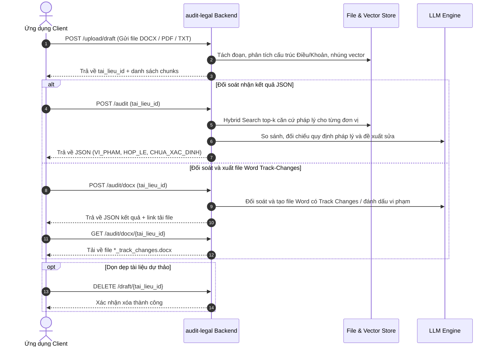

# TÀI LIỆU TÍCH HỢP API — HỆ THỐNG ĐỐI SOÁT PHÁP LÝ (AUDIT-LEGAL)

Tài liệu này cung cấp hướng dẫn tích hợp chi tiết toàn bộ các dịch vụ API của hệ thống **audit-legal** dành cho các hệ thống phần mềm nghiệp vụ (hệ thống soạn thảo văn bản, văn thư điện tử, cổng tra cứu pháp lý, ứng dụng trợ lý ảo...).

---

## 1. Thông tin chung

* **Base URL mặc định**: `http://{{base_url}}:{{port}}`
* **Swagger UI / OpenAPI Doc**: `http://{{base_url}}:{{port}}/docs`
* **Giao diện Web demo (SPA)**: `http://{{base_url}}:{{port}}/`
* **Chuẩn dữ liệu**:
  * Mã hóa ký tự: `UTF-8`
  * Dữ liệu gửi/nhận: `application/json` (trừ các endpoint tải file dùng `multipart/form-data`)
  * Cơ chế bảo mật & CORS: Hệ thống đã bật CORS (`Access-Control-Allow-Origin: *`) cho phép tích hợp trực tiếp từ Web Client/Frontend.
* **Thời gian xử lý (Timeout khuyến nghị)**:
  * Các API tra cứu dữ liệu (`/ask`, `/api/legal`, `/healthz`): timeout khuyến nghị **10s – 30s**.
  * Các API đối soát chuyên sâu (`/audit`, `/audit/docx`): Do chạy mô hình ngôn ngữ lớn (truy hồi vector kết hợp BM25 và gọi LLM phân tích từng đơn vị dự thảo), thời gian xử lý phụ thuộc vào độ dài file dự thảo. Khuyến nghị đặt HTTP Client timeout từ **60s – 120s**.

---

## 2. Sơ đồ quy trình tích hợp

### Luồng Đối soát Dự thảo Văn bản (Audit Workflow)



---

## 3. Danh mục API chi tiết

### Bảng tổng hợp Endpoint

| Phương thức | Đường dẫn | Chức năng chính |
| :--- | :--- | :--- |
| `GET` | `/healthz` | Kiểm tra trạng thái hoạt động của hệ thống |
| `POST` | `/upload/draft` | Tải lên file dự thảo (tự động phân đoạn và sinh embedding) |
| `POST` | `/audit` | Đối soát dự thảo văn bản với kho pháp luật (trả JSON) |
| `POST` | `/audit/docx` | Đối soát dự thảo và tự động tạo file Word Track Changes |
| `GET` | `/audit/docx/{tai_lieu_id}` | Tải file Word đã gắn Track Changes |
| `POST` | `/ask` | Trợ lý hỏi đáp pháp luật có trích dẫn điều khoản |
| `GET` | `/api/legal` | Tra cứu danh sách văn bản luật trong kho (phân trang, lọc, tìm kiếm) |
| `GET` | `/api/legal/loai` | Lấy danh sách các loại văn bản có trong kho CSDL |
| `GET` | `/legal/{van_ban_id}/html` | Xem toàn văn HTML |
| `DELETE` | `/draft/{tai_lieu_id}` | Xóa một tài liệu dự thảo và file đính kèm |
| `DELETE` | `/draft` | Xóa toàn bộ dữ liệu dự thảo thử nghiệm |

*(Lưu ý: API `/upload/legal` hiện không nằm trong phạm vi tài liệu này).*

---

### 3.1. Nhóm API Kiểm tra & Giám sát

#### `GET /healthz`

Kiểm tra dịch vụ backend có đang hoạt động bình thường không. Thích hợp cho Kubernetes liveness/readiness probe hoặc Healthcheck của API Gateway.

* **Request**:
  * Method: `GET`
  * URL: `/healthz`
  * Header: Không yêu cầu
* **Ví dụ cURL**:
  ```bash
  curl -X GET "http://{{base_url}}:{{port}}/healthz"
  ```
* **Response mẫu (200 OK)**:
  ```json
  {
    "status": "ok"
  }
  ```

---

### 3.2. Nhóm API Đối soát Văn bản Dự thảo (Audit)

#### `POST /upload/draft`

Tải lên file dự thảo văn bản. Hệ thống tự động bóc tách nội dung, phân đoạn thành các đơn vị pháp lý (Điều, Khoản, Điểm hoặc các đoạn văn logic), lưu trữ file gốc và tính toán vector embedding cho từng đoạn để phục vụ truy hồi đối chiếu.

* **Request**:
  * Method: `POST`
  * URL: `/upload/draft`
  * Content-Type: `multipart/form-data`
  * Form Field:
    * `file` (bắt buộc): Tệp nhị phân hỗ trợ định dạng `.docx`, `.pdf`, `.txt`.
* **Ví dụ cURL**:
  ```bash
  curl -X POST "http://{{base_url}}:{{port}}/upload/draft" \
    -F "file=@/duong/dan/du_thao_quy_dinh_tiep_dan.docx"
  ```
* **Response mẫu (200 OK)**:
  ```json
  {
    "tai_lieu_id": "8c593678-a28a-49f3-a15d-045330e70390",
    "so_don_vi": 8,
    "co_cau_truc_dieu": true,
    "can_cu_tho": [
      "Luật Tiếp công dân số 42/2013/QH13",
      "Nghị định số 64/2014/NĐ-CP"
    ],
    "chunks": [
      {
        "id": "8c593678-a28a-49f3-a15d-045330e70390-D1-K1",
        "cap": "khoan",
        "so_dieu": 1,
        "so_khoan": 1,
        "diem": null,
        "cau_goc": "1. Quyết định này quy định về nguyên tắc, thẩm quyền và trách nhiệm tiếp công dân...",
        "cau_de_doi_sanh": "Điều 1. Phạm vi điều chỉnh. 1. Quyết định này quy định về nguyên tắc, thẩm quyền..."
      },
      {
        "id": "8c593678-a28a-49f3-a15d-045330e70390-D4-K2",
        "cap": "khoan",
        "so_dieu": 4,
        "so_khoan": 2,
        "diem": null,
        "cau_goc": "2. Cán bộ tiếp công dân được từ chối tiếp đối với người không xuất trình được căn cước điện tử mức 2.",
        "cau_de_doi_sanh": "Điều 4. Từ chối tiếp công dân. 2. Cán bộ tiếp công dân được từ chối tiếp đối với người không xuất trình..."
      }
    ]
  }
  ```

---

#### `POST /audit`

Thực hiện đối soát toàn bộ các phân đoạn của dự thảo văn bản với kho pháp luật Việt Nam. Hệ thống sử dụng tìm kiếm lai (Hybrid Search: Vector + BM25 + Reciprocal Rank Fusion) để tìm các quy định pháp luật liên quan nhất trong kho, sau đó chạy song song mô hình ngôn ngữ lớn (LLM) để đối chiếu và phân loại từng đơn vị dự thảo thành 3 nhóm:
* `VI_PHAM`: Phát hiện nội dung trái luật, vượt thẩm quyền hoặc mâu thuẫn căn cứ pháp lý.
* `HOP_LE`: Phù hợp với các quy định pháp luật hiện hành.
* `CHUA_XAC_DINH`: Nội dung đặc thù, thủ tục nội bộ hoặc chưa tìm thấy quy phạm pháp luật tương ứng.

* **Request**:
  * Method: `POST`
  * URL: `/audit`
  * Content-Type: `application/json`
  * JSON Body Parameters:
    * `tai_lieu_id` (string, bắt buộc): ID tài liệu thu được từ bước `/upload/draft`.
    * `top_k` (int, tùy chọn, mặc định `8`, min `1`, max `10`): Tham số dự phòng giới hạn ứng viên (hiện tại số ứng viên gửi LLM được điều khiển chính bởi cấu hình `RERANK_TOP_N`).
    * `van_ban_me_ids` (array[string], tùy chọn, mặc định `null`): Danh sách ID văn bản luật cấp trên giới hạn phạm vi rà soát (ví dụ: `["11822", "14560"]`). Nếu để `null` hoặc rỗng, hệ thống sẽ tự động quét đối chiếu trên **toàn bộ kho pháp luật**.
    * `is_local` (boolean, tùy chọn, mặc định `null`): Chọn mô hình xử lý. `true` = Qwen local; `false` = Claude/Gemini; `null` = lấy theo cấu hình server `.env`.
    * `think` (boolean, tùy chọn, mặc định `null`): Cho phép bật/tắt luồng suy luận thinking của LLM local. `null` = lấy theo giá trị cấu hình server (`LLM_THINK` trong file `.env`); `true`/`false` = bật hoặc tắt cờ suy luận thinking.
* **Ví dụ cURL**:
  ```bash
  curl -X POST "http://{{base_url}}:{{port}}/audit" \
    -H "Content-Type: application/json" \
    -d '{
      "tai_lieu_id": "8c593678-a28a-49f3-a15d-045330e70390",
      "top_k": 8,
      "van_ban_me_ids": null,
      "is_local": true,
      "think": null
    }'
  ```
* **Response mẫu (200 OK)**:
  ```json
  {
    "tai_lieu_id": "8c593678-a28a-49f3-a15d-045330e70390",
    "thong_ke": {
      "VI_PHAM": 1,
      "HOP_LE": 6,
      "CHUA_XAC_DINH": 1
    },
    "ket_qua": {
      "VI_PHAM": [
        {
          "don_vi_id": "8c593678-a28a-49f3-a15d-045330e70390-D4-K2",
          "noi_dung_du_thao": "đối với người không xuất trình được căn cước điện tử mức 2.",
          "can_cu_phap_ly": {
            "so_hieu": "154/2026/NĐ-CP",
            "ten_van_ban": "Nghị định quy định chi tiết một số điều và biện pháp tổ chức thi hành Luật Tiếp công dân",
            "vi_tri": "Chương I Điều 4 khoản 1",
            "trich_dan": "Điều 4. Việc từ chối tiếp công dân\n1. Việc từ chối tiếp công dân được thực hiện trong các trường hợp quy định tại khoản 1, khoản 2 và khoản 3 Điều 9 Luật Tiếp công dân hoặc trong các trường hợp sau đây:...",
            "da_sua": true,
            "sua_boi": "Khoản 2, Điều 1 - Nghị định số 99/2026/NĐ-CP",
            "ngay_hieu_luc": "2026-07-01",
            "da_het_hieu_luc": false,
            "noi_dung_sau_sua": "Khoản 1 Điều 4 được sửa đổi bởi..."
          },
          "de_xuat_sua": ""
        }
      ],
      "HOP_LE": [
        {
          "don_vi_id": "8c593678-a28a-49f3-a15d-045330e70390-D1-K1",
          "noi_dung_du_thao": "1. Quyết định này quy định về nguyên tắc, thẩm quyền và trách nhiệm tiếp công dân...",
          "can_cu_phap_ly": {
            "so_hieu": "42/2013/QH13",
            "ten_van_ban": "Luật Tiếp công dân",
            "vi_tri": "Điều 1",
            "trich_dan": "Điều 1. Phạm vi điều chỉnh\nLuật này quy định về trách nhiệm tiếp công dân; quyền và nghĩa vụ của người khiếu nại, tố cáo, kiến nghị, phản ánh..."
          },
          "de_xuat_sua": ""
        }
      ],
      "CHUA_XAC_DINH": [
        {
          "don_vi_id": "8c593678-a28a-49f3-a15d-045330e70390-D8",
          "noi_dung_du_thao": "Điều 8. Tổ chức thực hiện và chế độ báo cáo nội bộ định kỳ hàng quý...",
          "can_cu_phap_ly": {},
          "de_xuat_sua": ""
        }
      ]
    }
  }
  ```

> [!TIP]
> **Quy ước trường `de_xuat_sua`**:
> * Khi `de_xuat_sua` có giá trị chữ: Đây là đoạn văn bản sửa đổi đề xuất thay thế cho đoạn `noi_dung_du_thao`.
> * Khi `de_xuat_sua` là chuỗi rỗng `""`: Đại diện cho phương án loại bỏ / bãi bỏ hoàn toàn đoạn nội dung vi phạm đó.

---

#### `POST /audit/docx`

Thực hiện đối soát toàn bộ như `/audit`, đồng thời xử lý trực tiếp trên file `.docx` gốc đã upload để tạo bản sao chứa **Word Track Changes và đánh dấu vi phạm**:
1. **Trường hợp có đề xuất sửa (`de_xuat_sua` khác rỗng)**: Hệ thống tạo Track Changes chuẩn OpenXML Word — thẻ `<w:del>` (gạch chữ đỏ) cho phần vi phạm và thẻ `<w:ins>` (gạch chân) cho nội dung sửa mới, kèm vạch đỏ lề trái và chú thích (Comment).
2. **Trường hợp không có đề xuất sửa (`de_xuat_sua` rỗng)**: Hệ thống tô màu đỏ đoạn văn bản vi phạm và gắn bóng chú thích (Comment) tác giả "AI LEGAL" neo vào đoạn văn bản, hiển thị đầy đủ thông tin căn cứ pháp lý, trích dẫn luật và cảnh báo sửa đổi/bãi bỏ (nếu có).

* **Request**:
  * Method: `POST`
  * URL: `/audit/docx`
  * Content-Type: `application/json`
  * Request Body: Hoàn toàn giống `POST /audit`.
* **Ví dụ cURL**:
  ```bash
  curl -X POST "http://{{base_url}}:{{port}}/audit/docx" \
    -H "Content-Type: application/json" \
    -d '{
      "tai_lieu_id": "8c593678-a28a-49f3-a15d-045330e70390",
      "is_local": true
    }'
  ```
* **Response mẫu (200 OK)**:
  Trả về toàn bộ các trường JSON như `POST /audit`, kèm theo thông tin file Word đã tạo:
  ```json
  {
    "tai_lieu_id": "8c593678-a28a-49f3-a15d-045330e70390",
    "thong_ke": {
      "VI_PHAM": 1,
      "HOP_LE": 6,
      "CHUA_XAC_DINH": 1
    },
    "ket_qua": { ... },
    "so_danh_dau": 1,
    "ten_file": "du_thao_quy_dinh_tiep_dan_track_changes.docx",
    "tai_file": "/audit/docx/8c593678-a28a-49f3-a15d-045330e70390"
  }
  ```

---

#### `GET /audit/docx/{tai_lieu_id}`

Tải file Word (.docx) đã được xử lý Track Changes về máy người dùng.

* **Request**:
  * Method: `GET`
  * URL: `/audit/docx/{tai_lieu_id}`
  * Header: Không yêu cầu
* **Ví dụ cURL**:
  ```bash
  curl -X GET "http://{{base_url}}:{{port}}/audit/docx/8c593678-a28a-49f3-a15d-045330e70390" \
    --output "ket_qua_track_changes.docx"
  ```
* **Response mẫu (200 OK)**:
  * Content-Type: `application/vnd.openxmlformats-officedocument.wordprocessingml.document`
  * Trả về luồng file nhị phân DOCX.

---

#### `DELETE /draft/{tai_lieu_id}`

Xóa một tài liệu dự thảo cụ thể khỏi cơ sở dữ liệu (cascade xóa toàn bộ phân đoạn và vector embedding), đồng thời dọn dẹp các tệp tin Word gốc và bản track-changes được lưu trữ trên ổ đĩa backend.

* **Request**:
  * Method: `DELETE`
  * URL: `/draft/{tai_lieu_id}`
* **Ví dụ cURL**:
  ```bash
  curl -X DELETE "http://{{base_url}}:{{port}}/draft/8c593678-a28a-49f3-a15d-045330e70390"
  ```
* **Response mẫu (200 OK)**:
  ```json
  {
    "tai_lieu_id": "8c593678-a28a-49f3-a15d-045330e70390",
    "da_xoa": true
  }
  ```

---

#### `DELETE /draft`

Dọn dẹp và làm rỗng toàn bộ dữ liệu các dự thảo trong kho rà soát (thường dùng trong kịch bản kiểm thử, kiểm thử tự động).

* **Request**:
  * Method: `DELETE`
  * URL: `/draft`
* **Ví dụ cURL**:
  ```bash
  curl -X DELETE "http://{{base_url}}:{{port}}/draft"
  ```
* **Response mẫu (200 OK)**:
  ```json
  {
    "da_xoa": 4
  }
  ```

---

### 3.3. Nhóm API Hỏi Đáp Pháp Luật (Legal QA / Chat)

#### `POST /ask`

Cho phép đặt câu hỏi pháp lý và nhận câu trả lời tổng hợp kèm các căn cứ trích dẫn cụ thể. API hỗ trợ hội thoại nhiều lượt (ghi nhớ ngữ cảnh qua tham số `lich_su`). Căn cứ pháp lý trả về bao gồm định danh (Số hiệu, Tên văn bản, Chương, Điều, Khoản, Điểm), nguyên văn trích dẫn gốc, điểm tương đồng RRF (`diem_rrf`), và cảnh báo tác động nếu điều khoản đó đã bị sửa đổi/bãi bỏ.

* **Request**:
  * Method: `POST`
  * URL: `/ask`
  * Content-Type: `application/json`
  * JSON Body Parameters:
    * `cau_hoi` (string, bắt buộc, tối đa 2000 ký tự): Nội dung câu hỏi pháp lý.
    * `top_k` (int, tùy chọn, mặc định `8`, min `1`, max `20`): Số lượng điều/khoản pháp lý phù hợp nhất cần truy xuất.
    * `is_local` (boolean, tùy chọn, mặc định `null`): `true` = Qwen local; `false` = Claude/Gemini.
    * `think` (boolean, tùy chọn, mặc định `null`): Bật/tắt suy luận thinking của mô hình local.
    * `lich_su` (array, tùy chọn): Danh sách các câu hỏi - đáp trước đó để duy trì ngữ cảnh trò chuyện. Mỗi phần tử là object `{"hoi": "...", "dap": "..."}`.
* **Ví dụ cURL**:
  ```bash
  curl -X POST "http://{{base_url}}:{{port}}/ask" \
    -H "Content-Type: application/json" \
    -d '{
      "cau_hoi": "Người khiếu nại có những quyền gì theo Luật Khiếu nại?",
      "top_k": 5,
      "is_local": true,
      "think": false,
      "lich_su": []
    }'
  ```
* **Response mẫu (200 OK)**:
  ```json
  {
    "tra_loi": "Theo quy định tại Điều 12 Luật Khiếu nại số 02/2011/QH13 (đã được sửa đổi, bổ sung tại Luật số 136/2025/QH15), người khiếu nại có các quyền cơ bản sau:\n1. Tự mình khiếu nại hoặc ủy quyền cho người đại diện hợp pháp.\n2. Nhờ luật sư hoặc trợ giúp viên pháp lý tư vấn, bảo vệ quyền lợi.\n3. Được biết, đọc, sao chụp tài liệu chứng cứ do người giải quyết khiếu nại thu thập (trừ bí mật nhà nước).\n4. Nhận văn bản trả lời về việc thụ lý, quyết định giải quyết khiếu nại, quyết định tạm đình chỉ hoặc đình chỉ giải quyết khiếu nại...",
    "can_cu": [
      {
        "so_tt": 1,
        "van_ban_id": "11822",
        "so_hieu": "02/2011/QH13",
        "ten_van_ban": "Luật Khiếu nại",
        "phan": null,
        "chuong": "Chương II. KHIẾU NẠI QUYẾT ĐỊNH HÀNH CHÍNH, HÀNH VI HÀNH CHÍNH",
        "so_dieu": 12,
        "so_khoan": 1,
        "diem": null,
        "trich_dan": "Điều 12. Quyền, nghĩa vụ của người khiếu nại\n1. Người khiếu nại có các quyền sau đây:\na) Tự mình khiếu nại...",
        "diem_rrf": 0.0328,
        "da_sua": {
          "loai": "sua_doi",
          "nhan": "bị sửa đổi, bổ sung",
          "nguon": "Khoản 5, Điều 2 - Luật số 136/2025/QH15",
          "ngay_hieu_luc": "2026-07-01",
          "da_het_hieu_luc": false,
          "noi_dung_sau_sua": "5. Sửa đổi, bổ sung điểm h khoản 1 Điều 12 như sau: “h) Nhận văn bản trả lời về việc thụ lý giải quyết khiếu nại, nhận quyết định giải quyết khiếu nại, quyết định tạm đình chỉ, quyết định đình chỉ giải quyết khiếu nại (nếu có);”."
        }
      }
    ],
    "so_can_cu": 1
  }
  ```

---

### 3.4. Nhóm API Tra Cứu Kho Pháp Luật (Legal Repository)

#### `GET /api/legal`

Tra cứu và phân trang danh mục các văn bản quy phạm pháp luật có trong cơ sở dữ liệu. Hỗ trợ lọc theo trạng thái hiệu lực, từ khóa, loại văn bản và khoảng thời gian ban hành/hiệu lực.

* **Request**:
  * Method: `GET`
  * URL: `/api/legal`
  * Query Parameters:
    * `q` (string, tùy chọn): Tìm kiếm gần đúng theo số hiệu văn bản hoặc tên gọi (ví dụ: `42/2013/QH13` hoặc `tiếp công dân`).
    * `con_hieu_luc` (boolean, tùy chọn, mặc định `true`): `true` = chỉ lấy văn bản hiện còn hiệu lực; `false` = lấy tất cả.
    * `loai` (string, tùy chọn): Lọc theo loại văn bản (ví dụ: `Luật`, `Nghị định`, `Thông tư`).
    * `tu_ngay` (date YYYY-MM-DD, tùy chọn): Ngày hiệu lực từ.
    * `den_ngay` (date YYYY-MM-DD, tùy chọn): Ngày hiệu lực đến.
    * `limit` (int, tùy chọn, mặc định `20`, tối đa `100`): Số lượng bản ghi trên một trang.
    * `offset` (int, tùy chọn, mặc định `0`): Vị trí bắt đầu lấy bản ghi (dùng cho phân trang).
* **Ví dụ cURL**:
  ```bash
  curl -X GET "http://{{base_url}}:{{port}}/api/legal?q=ti%E1%BA%BFp%20c%C3%B4ng%20d%C3%A2n&loai=Lu%E1%BA%ADt&limit=10&offset=0"
  ```
* **Response mẫu (200 OK)**:
  ```json
  {
    "total": 1,
    "items": [
      {
        "id": "14560",
        "so_hieu": "42/2013/QH13",
        "ten": "Luật Tiếp công dân",
        "loai": "Luật",
        "ngay_hieu_luc": "2014-07-01",
        "ngay_het_hieu_luc": null,
        "so_dieu": 36
      }
    ]
  }
  ```

---

#### `GET /api/legal/loai`

Lấy danh sách các loại văn bản quy phạm pháp luật thực tế đang tồn tại trong hệ thống (dùng để đổ dữ liệu vào bộ chọn dropdown trên UI phía client).

* **Request**:
  * Method: `GET`
  * URL: `/api/legal/loai`
* **Ví dụ cURL**:
  ```bash
  curl -X GET "http://{{base_url}}:{{port}}/api/legal/loai"
  ```
* **Response mẫu (200 OK)**:
  ```json
  [
    "Chỉ thị",
    "Luật",
    "Nghị định",
    "Nghị quyết",
    "Quyết định",
    "Thông tư",
    "Thông tư liên tịch"
  ]
  ```

---

#### `GET /legal/{van_ban_id}/html`

Xem trực tiếp toàn văn HTML của văn bản pháp luật được hệ thống thu thập từ cổng vbpl.vn (bao gồm đầy đủ bảng biểu, định dạng, tiêu đề điều khoản). Endpoint này trả về trực tiếp trang HTML, có thể nhúng vào thẻ `<iframe>` hoặc mở tab trình duyệt mới.

* **Request**:
  * Method: `GET`
  * URL: `/legal/{van_ban_id}/html`
  * Path Parameter: `van_ban_id` (string, ví dụ `14560`).
* **Ví dụ cURL**:
  ```bash
  curl -X GET "http://{{base_url}}:{{port}}/legal/14560/html"
  ```
* **Response mẫu (200 OK)**:
  * Content-Type: `text/html; charset=utf-8`
  * Trả về mã nguồn HTML hoàn chỉnh của toàn văn văn bản luật.

---

## 4. Xử lý lỗi & Mã trạng thái HTTP

Hệ thống áp dụng chuẩn mã phản hồi HTTP tiêu chuẩn:

| HTTP Code | Ý nghĩa | Chi tiết xử lý |
| :--- | :--- | :--- |
| `200 OK` | Thành công | Yêu cầu được thực thi chính xác. Dữ liệu trả về đúng schema định nghĩa. |
| `400 Bad Request` | Lỗi tham số | Dữ liệu đầu vào sai định dạng, file upload không đọc được hoặc tham số JSON không hợp lệ. |
| `404 Not Found` | Không tìm thấy | `tai_lieu_id` hoặc `van_ban_id` không tồn tại trong hệ thống. |
| `422 Unprocessable`| Dữ liệu rỗng | File dự thảo sau khi bóc tách không tìm thấy bất kỳ câu/đoạn nội dung nào. |
| `500 Server Error` | Lỗi hệ thống | Lỗi kết nối CSDL PostgreSQL hoặc lỗi trong quá trình thực thi mô hình LLM. |

* **Định dạng JSON thông báo lỗi chung**:
  ```json
  {
    "detail": "tai_lieu_id 'xyz' khong ton tai"
  }
  ```

---

## 5. Hướng dẫn tích hợp mẫu (Code Snippets)

### Ví dụ bằng Python (sử dụng thư viện `requests`)

```python
import time
import requests

BASE_URL = "http://{{base_url}}:{{port}}"

# 1. Tải lên file dự thảo
print("1. Đang tải lên dự thảo...")
with open("du_thao_sample.docx", "rb") as f:
    resp = requests.post(f"{BASE_URL}/upload/draft", files={"file": f})
resp.raise_for_status()
draft_data = resp.json()
tai_lieu_id = draft_data["tai_lieu_id"]
print(f"-> Upload thành công! tai_lieu_id: {tai_lieu_id} ({draft_data['so_don_vi']} đơn vị)")

# 2. Thực hiện đối soát và xuất file Word Track Changes
print("2. Đang thực hiện đối soát pháp lý...")
audit_resp = requests.post(
    f"{BASE_URL}/audit/docx",
    json={"tai_lieu_id": tai_lieu_id, "is_local": True}
)
audit_resp.raise_for_status()
audit_data = audit_resp.json()

print(f"-> Kết quả: {audit_data['thong_ke']}")
for vp in audit_data["ket_qua"]["VI_PHAM"]:
    cc = vp.get("can_cu_phap_ly", {})
    print(f"[VI PHẠM] Đoạn: {vp['noi_dung_du_thao']}")
    print(f"  Căn cứ: {cc.get('so_hieu')} - {cc.get('vi_tri')} ({cc.get('ten_van_ban')})")
    print(f"  Đề xuất sửa: {vp.get('de_xuat_sua') or '(Bỏ đoạn này)'}")

# 3. Tải file Word kết quả Track Changes
if audit_data.get("tai_file"):
    download_url = f"{BASE_URL}{audit_data['tai_file']}"
    file_resp = requests.get(download_url)
    with open("ket_qua_track_changes.docx", "wb") as out_f:
        out_f.write(file_resp.content)
    print("-> Đã tải file Word Track Changes: ket_qua_track_changes.docx")

# 4. Dọn dẹp tài liệu dự thảo
requests.delete(f"{BASE_URL}/draft/{tai_lieu_id}")
print("-> Đã xóa dữ liệu dự thảo tạm.")
```

### Ví dụ bằng JavaScript / TypeScript (Node.js hoặc Trình duyệt)

```javascript
const BASE_URL = "http://{{base_url}}:{{port}}";

// Hỏi đáp pháp lý trực tiếp
async function hoiDapPhapLuat(cauHoi) {
  const response = await fetch(`${BASE_URL}/ask`, {
    method: "POST",
    headers: { "Content-Type": "application/json" },
    body: JSON.stringify({
      cau_hoi: cauHoi,
      top_k: 5,
      is_local: true,
      lich_su: []
    })
  });
  
  if (!response.ok) {
    throw new Error(`Lỗi API: ${response.statusText}`);
  }
  
  const data = await response.json();
  console.log("Câu trả lời:", data.tra_loi);
  console.log("Căn cứ pháp lý:", data.can_cu);
  return data;
}

// Gọi thử nghiệm
hoiDapPhapLuat("Thời hạn khiếu nại lần đầu là bao nhiêu ngày?");
```
