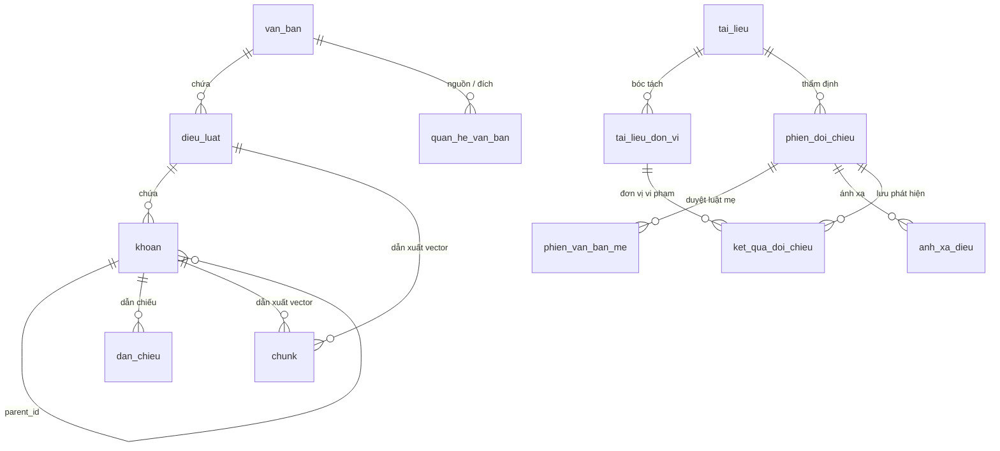
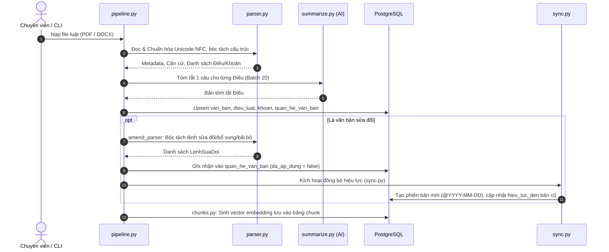
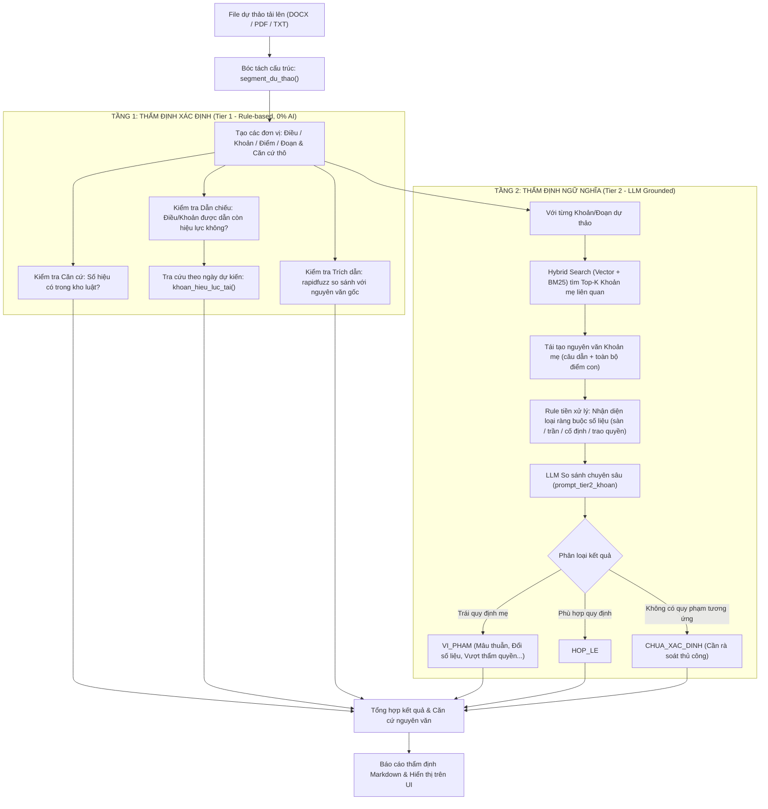

# TỔNG QUAN KIẾN TRÚC HỆ THỐNG & CƠ SỞ DỮ LIỆU `audit-legal`
> **Tài liệu phân tích kỹ thuật toàn diện**  
> **Dự án**: audit-legal — Service đối chiếu văn bản dự thảo với kho pháp luật Việt Nam  
> **Phiên bản**: v0.4.0  

---

## 1. TỔNG QUAN HỆ THỐNG & MIỀN NGHIỆP VỤ (SYSTEM OVERVIEW)

### 1.1. Mục tiêu & Bài toán nghiệp vụ
Dự án **`audit-legal`** là giải pháp chuyên sâu trong lĩnh vực LegalTech và GovTech, giải quyết bài toán: **Tự động đối chiếu, thẩm định văn bản dự thảo (nghị định, thông tư, quy chế nội bộ, hợp đồng...) với hệ thống văn bản quy phạm pháp luật của Việt Nam**.

Hệ thống tập trung phát hiện:
* Sai sót trong viện dẫn, dẫn chiếu pháp lý (dẫn văn bản không tồn tại, sai số hiệu, đã hết hiệu lực hoặc bị bãi bỏ).
* Mâu thuẫn nội dung, vượt thẩm quyền so với văn bản cấp trên.
* Bóp méo quy định: Thay đổi số liệu (ngày, giờ, tỷ lệ %, độ tuổi, mức phạt), thu hẹp/mở rộng phạm vi điều chỉnh, đặt thêm điều kiện hoặc thủ tục trái luật.
* Trích dẫn sai lệch nguyên văn câu chữ của luật.
* Đồng thời cung cấp kênh **Hỏi - Đáp Pháp Lý (Legal RAG Chatbot)** với nguyên tắc căn cứ thực tế 100%.

### 1.2. Triết lý thiết kế cốt lõi
1. **Không dùng Framework AI cồng kềnh (No LangChain / LlamaIndex)**:
   * Toàn bộ pipeline được kiểm soát trực tiếp bằng Python thuần, [FastAPI](file:///d:/AUDIT/audit-legal/app/api/main.py) và [psycopg3 ConnectionPool](file:///d:/AUDIT/audit-legal/app/db/session.py).
   * Giúp hệ thống đạt hiệu năng cao, giảm độ trễ tối đa, minh bạch logic tính toán và quản trị chặt chẽ ngữ cảnh token.
2. **Cơ chế sự thật theo trục thời gian (Temporal Legal Validity Engine)**:
   * Luật pháp luôn có sửa đổi, bổ sung, bãi bỏ theo thời gian. Hệ thống không ghi đè dữ liệu cũ khi có luật sửa đổi mà phiên bản hóa Điều/Khoản kèm mốc hiệu lực. Mọi truy vấn tra cứu đều bắt buộc gắn với một ngày cụ thể (`p_ngay`).
3. **Chiến lược thẩm định 2 tầng (Two-Tier Audit Strategy)**:
   * **Tier 1 (Xác định - 0% LLM)**: Chạy nhanh bằng quy tắc luật học, regex và so khớp chuỗi [rapidfuzz](file:///d:/AUDIT/audit-legal/app/audit/tier1.py) (kiểm tra hiệu lực, dẫn chiếu, căn cứ, trích nguyên văn).
   * **Tier 2 (Ngữ nghĩa chuyên sâu - LLM Grounded)**: Dùng LLM so sánh từng Khoản dự thảo với các Khoản luật mẹ tương ứng, phân tích logic ràng buộc số liệu (sàn, trần, cố định, trao quyền).
4. **Triệt tiêu ảo giác (Zero-Hallucination Grounding)**:
   * Mọi phát hiện vi phạm bắt buộc phải gắn liền với bản ghi thật trong DB (`dieu_luat.id` / `khoan.id`) và đoạn trích dẫn nguyên văn phải so khớp khớp với luật gốc (fuzz partial $\ge 85\%$). Không có căn cứ $\rightarrow$ không được kết luận vi phạm.
5. **Cơ chế LLM Kép (Dual-LLM Engine)**:
   * Chuyển đổi linh hoạt giữa **Local LLM** (Qwen3:14B qua Ollama phục vụ triển khai On-Premise bảo mật dữ liệu) và **Cloud LLM** (Gemini 3.5 Flash Lite qua OpenAI-compatible API cho tốc độ và khả năng suy luận sắc bén).

---

## 2. PHÂN TÍCH CHI TIẾT CƠ SỞ DỮ LIỆU (DATABASE ARCHITECTURE)

Hệ thống triển khai trên **PostgreSQL 16** tích hợp extension **`pgvector`** (vector 1024 chiều từ model `bge-m3`). Lược đồ gồm **17 bảng**, **5 Stored Functions** và **1 View** định nghĩa tại [`migrations/001_init.sql`](file:///d:/AUDIT/audit-legal/migrations/001_init.sql).



### 2.1. Phân hệ Kho Pháp Luật (Ground Truth)
* **`van_ban`**: Quản lý metadata văn bản luật (`so_hieu`, `ten`, `loai`, `cap` [1-Hiến pháp $\rightarrow$ 8-Địa phương], `ngay_ban_hanh`, `ngay_hieu_luc`, `ngay_het_hieu_luc`, `la_van_ban_sua_doi`, `linh_vuc`).
* **`dieu_luat`**: Lưu trữ các Điều luật (`so_dieu`, `so_dieu_num`, `chuong_so`, `tieu_de`, `noi_dung`, `tom_tat` 1 câu do LLM tạo). Hỗ trợ phiên bản theo thời gian qua `hieu_luc_tu`, `hieu_luc_den`, `thay_boi_id`, `nguon_sua_doi_id`.
* **`khoan`**: Chi tiết từng Khoản và Điểm con (cấu trúc cây phân cấp qua `parent_id`), thứ tự sắp xếp và khoảng hiệu lực thời gian.
* **`quan_he_van_ban`**: Đồ thị quan hệ pháp lý liên văn bản (`sua_doi`, `bo_sung`, `thay_the`, `bai_bo`, `huong_dan`, `quy_dinh_chi_tiet`, `can_cu`, `thay_cum_tu`), theo dõi trạng thái thi hành lệnh sửa đổi (`da_ap_dung`).
* **`dan_chieu`**: Lưu vết các trích dẫn pháp lý xuất hiện trong văn bản luật hoặc dự thảo tới điều khoản đích tương ứng.

### 2.2. Phân hệ Dữ liệu Tìm Kiếm Dẫn Xuất (Search Index)
* **`chunk`**: Dẫn xuất từ `dieu_luat` hoặc `khoan`. Lưu trữ `text_goc`, `text_embed`, vector `embedding vector(1024)` và cột `tsv_goc = to_tsvector('simple', text_goc)` kèm GIN Index phục vụ tìm kiếm lai kết hợp (Hybrid Search).

### 2.3. Phân hệ Dự Thảo Người Dùng (User Draft Documents)
* **`tai_lieu`**: Lưu trữ văn bản dự thảo tải lên (`cap_tuong_duong`, `ngay_du_kien`, `can_cu_tho` trích thô, hash SHA256 của file, `storage_key`).
* **`tai_lieu_don_vi`**: Bóc tách nội dung dự thảo thành từng đơn vị phân cấp (`dieu`, `khoan`, `diem`, `doan`, `cum`) kèm mã hash nội dung phục vụ phát hiện thay đổi và caching.

### 2.4. Phân hệ Đối Chiếu & Thẩm Định (Audit Engine)
* **`phien_doi_chieu`**: Quản lý phiên làm việc, trạng thái tiến độ (`tao`, `cho_duyet_vb_me`, `tier1`, `cho_duyet_anh_xa`, `tier2`, `fallback`, `xong`), thống kê độ trễ và số lượt gọi AI.
* **`phien_van_ban_me`**: Danh sách văn bản mẹ áp dụng cho phiên kèm nguồn suy luận và trạng thái duyệt (`de_xuat`, `chap_nhan`, `loai_bo`).
* **`anh_xa_dieu`**: Bản đồ ánh xạ đơn vị dự thảo $\leftrightarrow$ Điều luật mẹ.
* **`ket_qua_doi_chieu`**: Bảng lưu vết toàn bộ phát hiện lỗi (tầng 1/2/3, loại lỗi, mức độ nghiêm trọng, căn cứ văn bản/điều/khoản, đoạn trích dẫn nguyên văn, nội dung dự thảo sai, lời giải thích và đề xuất chỉnh sửa).
* **`tier2_cache`**: Bộ nhớ đệm kết quả so sánh LLM theo `hash_cap` và cấu hình model, giúp bỏ qua các Điều không thay đổi khi tải lên phiên bản dự thảo kế tiếp.
* **`chu_de_van_ban_me`**: Bảng tham chiếu gợi ý văn bản mẹ theo thể loại dự thảo và lĩnh vực chuyên môn.

### 2.5. Phân hệ Đánh Giá & Đo Lường (Benchmark & Migrations)
* **`eval_case`**, **`eval_run`**: Lưu trữ các test case mẫu có tiêm lỗi (ground truth) để đo đạc chỉ số Precision và Recall của hệ thống.
* **`schema_migrations`**: Ghi nhận lịch sử áp dụng migrations đảm bảo tính idempotent.

### 2.6. Các Stored Functions & Views Cốt Lõi
| Tên Function / View | Chức năng kỹ thuật |
| :--- | :--- |
| `khoan_hieu_luc_tai()` | Lấy bản ghi Khoản/Điểm có hiệu lực chính xác tại mốc ngày `p_ngay`. |
| `dieu_hieu_luc_tai()` | Lấy bản ghi Điều luật có hiệu lực chính xác tại mốc ngày `p_ngay`. |
| `ban_hop_nhat()` | Tự động tổng hợp toàn bộ các Điều luật còn hiệu lực của 1 văn bản tại 1 ngày cụ thể (văn bản hợp nhất động). |
| `van_ban_me_qua_do_thi()` | Đệ quy đồ thị quan hệ văn bản (`quan_he_van_ban`) tìm văn bản mẹ cấp trên tối đa 2 bước. |
| `tim_kiem_hybrid()` | Thuật toán **Hybrid Search** kết hợp Cosine Distance (`<=>`) và Full-Text Search BM25 (`ts_rank_cd`), dung hòa qua **Reciprocal Rank Fusion (RRF, $k=60$)**. |
| `van_ban_trang_thai_tinh` | View tự động tính trạng thái hiệu lực động của văn bản. |

---

## 3. PHÂN TÍCH CẤU TRÚC CODEBASE & CÁC MODULE

Mã nguồn được tổ chức theo chuẩn kiến trúc hướng module (Modular Clean Architecture):

```
audit-legal/
├── app/
│   ├── config.py             # Cấu hình hệ thống, quản lý switch LLM Local / Gemini
│   ├── db/                   # Data Access Layer (DAL)
│   │   ├── session.py        # ConnectionPool psycopg3
│   │   ├── repo_van_ban.py   # Quản lý văn bản, Điều, Khoản
│   │   ├── repo_hieu_luc.py  # Xử lý hiệu lực & thi hành lệnh sửa đổi
│   │   ├── repo_tai_lieu.py  # Quản lý tài liệu dự thảo & phân đoạn
│   │   └── repo_audit.py     # Quản lý phiên đối chiếu, kết quả & cache
│   ├── models/               # Domain Models & AI Connectors
│   │   ├── schemas.py        # Định nghĩa kiểu dữ liệu Pydantic v2
│   │   ├── llm.py            # Client OpenAI-compatible (retry, clean JSON, disable thinking)
│   │   └── embedder.py       # Client vector embedding (bge-m3)
│   ├── ingestion/            # Pipeline xử lý văn bản quy phạm pháp luật
│   │   ├── loader.py         # Đọc file PDF, DOCX, TXT
│   │   ├── normalize.py      # Chuẩn hóa văn bản tiếng Việt & Unicode NFC
│   │   ├── parser.py         # Bộ Regex Parser bóc tách Chương/Mục/Điều/Khoản/Điểm
│   │   ├── amend_parser.py   # Parse lệnh sửa đổi/bổ sung/bãi bỏ từ văn bản sửa đổi
│   │   ├── citation_parser.py# Nhận diện dẫn chiếu pháp lý
│   │   ├── summarize.py      # Tóm tắt 1 câu cho mỗi Điều (LLM batch)
│   │   ├── quan_he.py        # Tạo liên kết căn cứ & quy định chi tiết
│   │   ├── sync.py           # Máy trạng thái thi hành lệnh sửa đổi
│   │   ├── chunks.py         # Chunking & embed vào bảng chunk
│   │   └── pipeline.py       # Điều phối toàn bộ luồng nạp văn bản luật
│   ├── audit/                # Trọng tâm thuật toán thẩm định đối chiếu
│   │   ├── segment.py        # Phân đoạn dự thảo (có Điều hoặc không có Điều)
│   │   ├── parent_docs.py    # Xác định văn bản mẹ theo 5 nguồn ưu tiên
│   │   ├── consolidate.py    # Tập hợp bản hợp nhất luật mẹ theo ngày tra
│   │   ├── tier1.py          # Thẩm định tầng 1: Dẫn chiếu, hiệu lực, trích nguyên văn
│   │   ├── mapping.py        # LLM ánh xạ Điều dự thảo <-> Điều mẹ
│   │   ├── focus_khoan.py    # Hybrid Search lọc top Khoản mẹ phù hợp cho từng Khoản
│   │   ├── tier2.py          # Thẩm định tầng 2: Phân tích nội dung & ràng buộc số liệu
│   │   ├── fallback.py       # Xử lý Điều mồ côi (không tìm thấy căn cứ)
│   │   ├── prompts.py        # Toàn bộ System Prompt & Rule-based Prompting
│   │   ├── workflow.py       # Điều phối luồng thẩm định stateful (dừng - duyệt - chạy)
│   │   └── report.py         # Biên xuất báo cáo Markdown kết quả thẩm định
│   ├── retrieval/
│   │   └── hybrid.py         # Tìm kiếm kết hợp (BM25 + Dense Vector)
│   ├── qa/
│   │   └── chat.py           # Hỏi - đáp pháp lý Legal RAG có trích dẫn chỉ mục [1], [2]
│   └── api/                  # Giao diện lập trình & Tương tác người dùng
│       ├── main.py           # Entrypoint FastAPI, CORS & static mount
│       ├── routes_simple.py  # 4 API tinh gọn (/ask, /legal, /upload/draft, /audit)
│       └── static/index.html # Giao diện Web SPA tương tác trực tiếp
├── migrations/               # Database SQL migrations (001_init.sql)
├── scripts/                  # Bộ công cụ CLI vận hành & đánh giá tự động
│   ├── init_db.py            # Khởi tạo DB
│   ├── ingest.py             # CLI nạp văn bản luật
│   ├── sync.py               # CLI đồng bộ hiệu lực
│   ├── audit.py              # CLI chạy thẩm định
│   ├── eval_audit.py         # CLI benchmark đo lường độ chính xác
│   ├── seed_demo.py          # CLI nạp dữ liệu demo
│   └── embed_all.py          # CLI tính toán vector embedding cho toàn bộ kho
└── tests/                    # Bộ kiểm thử tự động (Unit & Integration tests)
```

---

## 4. CẤU TRÚC HỆ THỐNG & CÁC LUỒNG DỮ LIỆU CHÍNH

### 4.1. Luồng nạp luật & Đồng bộ hiệu lực thời gian thực (Ingestion Flow)


---

### 4.2. Luồng thẩm định đối chiếu dự thảo 2 tầng (Two-Tier Audit Flow)


#### Quy tắc xử lý ràng buộc số liệu (Rule-based Pre-check):
1. **Sàn (`san`)**: *"ít nhất", "tối thiểu", "không thấp hơn"* $\rightarrow$ Dự thảo thấp hơn sàn: `VI_PHAM`. Bằng hoặc cao hơn: `HOP_LE`.
2. **Trần (`tran`)**: *"không quá", "tối đa", "không vượt quá"* $\rightarrow$ Dự thảo cao hơn trần: `VI_PHAM`. Bằng hoặc thấp hơn: `HOP_LE`.
3. **Cố định (`co_dinh`)**: Con số ấn định cố định $\rightarrow$ Dự thảo khác con số này: `VI_PHAM` (`doi_so_lieu`).
4. **Trao quyền (`trao_quyen`)**: *"do ... quy định", "theo thỏa thuận"* $\rightarrow$ Dự thảo quy định mức cụ thể trong thẩm quyền: `HOP_LE`.

---

### 4.3. Luồng hỏi đáp pháp lý (Legal RAG QA Flow)
Triển khai tại [`app/qa/chat.py`](file:///d:/AUDIT/audit-legal/app/qa/chat.py):
1. Nhận câu hỏi từ người dùng.
2. Embed câu hỏi và thực hiện truy vấn lai qua stored function [`tim_kiem_hybrid()`](file:///d:/AUDIT/audit-legal/app/retrieval/hybrid.py).
3. Truy xuất nội dung văn bản gốc, số hiệu, Điều, Khoản của các chunk liên quan nhất.
4. Đóng gói vào System Prompt yêu cầu trợ lý trả lời chỉ dựa trên căn cứ đã cấp, bắt buộc đánh số trích dẫn `[1]`, `[2]`. Nếu không đủ thông tin, thông báo rõ *"Tôi không có đủ căn cứ"* và liệt kê phần còn thiếu.

---

## 5. BẢNG TỔNG HỢP CÔNG NGHỆ & THƯ VIỆN

| Phân hệ / Thư viện | Phiên bản | Vai trò kỹ thuật |
| :--- | :--- | :--- |
| **Python** | $\ge 3.10$ | Ngôn ngữ phát triển cốt lõi |
| **FastAPI** | $\ge 0.110$ | Framework xây dựng REST API bất đồng bộ tốc độ cao |
| **Uvicorn** | $\ge 0.29$ | ASGI Web Server |
| **PostgreSQL & pgvector** | 16 / $\ge 0.3$ | Hệ quản trị cơ sở dữ liệu quan hệ kết hợp Vector Database |
| **Psycopg 3** | $\ge 3.2$ | Driver kết nối PostgreSQL, hỗ trợ `ConnectionPool` |
| **Pydantic & Pydantic-Settings** | $\ge 2.6$ | Định nghĩa Schema và kiểm soát biến môi trường |
| **PyMuPDF (fitz)** | $\ge 1.24$ | Trích xuất văn bản từ tài liệu PDF |
| **python-docx** | $\ge 1.1$ | Trích xuất văn bản từ file Word (.docx) |
| **RapidFuzz** | $\ge 3.6$ | So khớp chuỗi mờ (Fuzzy string matching) phát hiện sai lệch trích dẫn |
| **HTTPX & Tenacity** | $\ge 0.27$ / $\ge 8.2$ | Gọi API LLM qua HTTP với cơ chế tự động thử lại (Retry backoff 3 lần) |
| **Structlog & Rich** | $\ge 24.1$ / $\ge 13.7$ | Ghi nhật ký hệ thống (Structured Logging) và định dạng console |
| **Mô hình AI Local** | Qwen3:14B | Xử lý ngôn ngữ tự nhiên offline qua Ollama |
| **Mô hình AI Cloud** | Gemini 3.5 Flash Lite | Xử lý ngôn ngữ tự nhiên trên cloud tốc độ cao |
| **Mô hình Embedding** | BGE-M3 (1024-dim) | Mô hình nhúng đa ngôn ngữ chuyên sâu cho văn bản pháp lý |

---

## 6. ĐÁNH GIÁ CHUYÊN GIA & KHUYẾN NGHỊ PHÁT TRIỂN

### 6.1. Điểm mạnh vượt trội (Strengths)
1. **Mô hình hóa sâu sắc miền nghiệp vụ pháp lý**: Không xử lý văn bản như các đoạn văn bản ngẫu nhiên mà tuân thủ tuyệt đối cấu trúc pháp lý Việt Nam (*Văn bản $\rightarrow$ Chương $\rightarrow$ Mục $\rightarrow$ Điều $\rightarrow$ Khoản $\rightarrow$ Điểm*).
2. **Khả năng đối chiếu theo thời điểm (Time-travel Audit)**: Giải quyết xuất sắc bài toán hiệu lực văn bản tại một thời điểm tương lai bất kỳ.
3. **Kiểm soát ảo giác nghiêm ngặt**: Ép buộc mọi phát hiện vi phạm phải có trích dẫn nguyên văn thật từ DB và so khớp chuỗi $\ge 85\%$.
4. **Kiến trúc tinh gọn, hiệu năng cao**: Loại bỏ hoàn toàn các lớp bọc (wrapper) phức tạp của LangChain/LlamaIndex giúp mã nguồn trong sáng, dễ mở rộng và dễ bảo trì.

### 6.2. Khuyến nghị nâng cấp tiếp theo (Next Steps)
1. **Chuyển đổi tác vụ nền sang Message Queue**:
   * Hiện tại việc đối chiếu nhiều Điều đang dùng `concurrent.futures.ThreadPoolExecutor` trong tiến trình API. Khi số lượng Điều tăng lên hoặc có nhiều người dùng đồng thời, nên tích hợp Celery / Redis Queue để quản lý job nền ổn định.
2. **Bổ sung chỉ mục HNSW cho vector**:
   * Cột `chunk.embedding` hiện chưa được đánh index HNSW (mới chỉ đánh GIN index cho `tsv_goc`). Khi kho luật vượt quá 10.000 Điều, cần thực thi lệnh:
     ```sql
     CREATE INDEX IF NOT EXISTS chunk_embedding_hnsw 
     ON chunk USING hnsw (embedding vector_cosine_ops);
     ```
3. **Áp dụng Alembic cho Migration**:
   * Chuyển dần từ script chạy SQL thủ công [`scripts/init_db.py`](file:///d:/AUDIT/audit-legal/scripts/init_db.py) sang Alembic để quản lý các bước rollback và versioning schema chuyên nghiệp khi triển khai môi trường Production.

